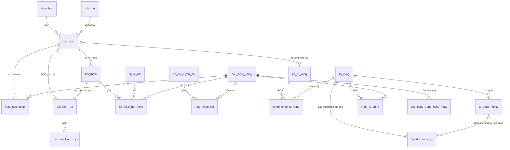

# Thiết kế database: Chinese Learning

Database cho app học tiếng Trung (Next.js), thiết kế theo đúng các màn hình hiện có: trang chủ, Học ngay, Ôn tập, Luyện nghe, Luyện nói, Viết chữ, HSK, Thành tích, Tài khoản.

| File | Nội dung |
|---|---|
| [schema.sql](schema.sql) | Tạo toàn bộ bảng, index, ràng buộc và hàm tiện ích. **Đây là nguồn chuẩn**: nếu tài liệu này lệch với schema, schema đúng. |
| [seed.sql](seed.sql) | Dữ liệu mẫu chuyển từ `src/data/*.ts` và một người học mẫu (Minh Anh). |
| [queries.sql](queries.sql) | Truy vấn cho từng khối trên UI, viết sẵn tham số `$1, $2` để dùng với `pg`. |
| [2026-11-24-normalize-vocabulary.sql](migrations/2026-11-24-normalize-vocabulary.sql) | Chuẩn hóa nghĩa từ, nhập từ bài đọc vào từ điển và phân cấp HSK. |

**Hệ quản trị:** PostgreSQL 14 trở lên, cần extension `pg_trgm` (Supabase, Neon, Vercel Postgres đều có sẵn).

**Tại sao PostgreSQL:** có `jsonb` và mảng cho nội dung bài học, partial index (ví dụ "mỗi người chỉ một khoá đang học"), cột sinh tự động (pinyin không dấu), xử lý múi giờ tốt (cần cho streak), và tìm kiếm gần đúng bằng trigram.

---

## 1. Tổng quan

38 bảng, chia 5 nhóm:

| Nhóm | Tên bảng trong PostgreSQL | Chức năng |
|---|---|---|
| Tài khoản | `nguoi_dung` | Tài khoản người học, XP, cấp độ và streak |
| Tài khoản | `cai_dat_nguoi_dung` | Mục tiêu, múi giờ và tùy chọn học |
| Tài khoản | `phien_dang_nhap` | Phiên đăng nhập và thời hạn phiên |
| Tài khoản | `thong_bao` | Thông báo của người học |
| Tài khoản | `phan_hoi` | Đánh giá và góp ý |
| Nội dung học | `khoa_hoc` | Các khóa học HSK |
| Nội dung học | `chu_de` | Chủ đề học tập |
| Nội dung học | `bai_hoc` | Bài học và các bước học |
| Nội dung học | `bai_doc` | Bài đọc theo HSK, bản dịch, pinyin, JSONB từ vựng tương thích và ảnh tùy chọn |
| Nội dung học | `cau_tieng_trung` | Câu tiếng Trung, pinyin, âm thanh và nghĩa |
| Nội dung học | `tu_vung` | Từ vựng và thông tin tra cứu |
| Nội dung học | `tu_vung_nghia` | Các nghĩa và từ loại của một từ |
| Nội dung học | `vi_du_tu_vung` | Liên kết từ vựng với câu ví dụ |
| Nội dung học | `bai_doc_tu_vung` | Liên kết từ điển với từ trọng tâm của bài đọc |
| Nội dung học | `mau_ngu_phap` | Mẫu ngữ pháp trong bài học |
| Nội dung học | `nguoi_noi` | Nhân vật/người nói trong hội thoại |
| Nội dung học | `hoi_thoai` | Nội dung bài hội thoại và bài nghe |
| Nội dung học | `loi_thoai_hoi_thoai` | Các câu theo thứ tự trong hội thoại |
| Nội dung học | `bai_kiem_tra` | Bài kiểm tra gắn với bài học hoặc hội thoại |
| Nội dung học | `cau_hoi_kiem_tra` | Câu hỏi và đáp án của bài kiểm tra |
| Nội dung học | `bo_bai_luyen_noi` | Bộ bài luyện nói theo chủ đề |
| Nội dung học | `muc_luyen_noi` | Các câu trong một bộ luyện nói |
| Nội dung học | `chu_han` | Chữ Hán và dữ liệu nét viết |
| Nội dung học | `cau_tieng_trung_hang_ngay` | Câu tiếng Trung theo ngày |
| Từ vựng và ôn tập | `bo_tu_vung` | Bộ từ theo HSK, bài học, chủ đề hoặc cá nhân |
| Từ vựng và ôn tập | `tu_trong_bo_tu_vung` | Từ và thứ tự từ trong mỗi bộ |
| Từ vựng và ôn tập | `bo_tu_vung_nguoi_dung` | Các bộ từ người học đã thêm |
| Từ vựng và ôn tập | `the_on_tap` | Trạng thái và lịch ôn từng từ của người học |
| Từ vựng và ôn tập | `lich_su_on_tap` | Lịch sử chấm thẻ ôn tập |
| Tiến độ | `khoa_hoc_nguoi_dung` | Khóa học và trạng thái khóa của người học |
| Tiến độ | `tien_do_bai_hoc` | Tiến độ từng bài học, gồm thời điểm hoàn thành |
| Tiến độ | `lan_lam_bai_kiem_tra` | Kết quả từng lần làm bài kiểm tra |
| Tiến độ | `lan_luyen_noi` | Kết quả từng lần luyện nói |
| Tiến độ | `lan_luyen_viet` | Kết quả từng lần luyện viết chữ |
| Động lực | `hoat_dong_hang_ngay` | Thời gian và hoạt động học theo ngày |
| Động lực | `su_kien_xp` | Sổ ghi nhận XP được cộng |
| Động lực | `mau_muc_tieu_hang_ngay` | Các mục tiêu học tập hằng ngày |
| Động lực | `thanh_tuu` | Danh mục thành tích |
| Động lực | `thanh_tuu_nguoi_dung` | Thành tích người học đã đạt |

### Sơ đồ: nội dung học



### Sơ đồ: người học

```mermaid
erDiagram
  nguoi_dung ||--o| cai_dat_nguoi_dung        : ""
  nguoi_dung ||--o{ phien_dang_nhap             : ""
  nguoi_dung ||--o{ khoa_hoc_nguoi_dung         : ""
  nguoi_dung ||--o{ tien_do_bai_hoc : ""
  nguoi_dung ||--o{ bo_tu_vung_nguoi_dung           : ""
  nguoi_dung ||--o{ the_on_tap            : ""
  nguoi_dung ||--o{ lan_lam_bai_kiem_tra        : ""
  nguoi_dung ||--o{ lan_luyen_noi    : ""
  nguoi_dung ||--o{ lan_luyen_viet     : ""
  nguoi_dung ||--o{ hoat_dong_hang_ngay  : ""
  nguoi_dung ||--o{ su_kien_xp            : ""
  nguoi_dung ||--o{ thanh_tuu_nguoi_dung    : ""
  nguoi_dung ||--o{ thong_bao        : ""
  nguoi_dung |o--o{ phan_hoi             : ""
  khoa_hoc          ||--o{ khoa_hoc_nguoi_dung         : ""
  bai_hoc          ||--o{ tien_do_bai_hoc : ""
  bo_tu_vung            ||--o{ bo_tu_vung_nguoi_dung           : ""
  tu_vung            ||--o{ the_on_tap            : ""
  the_on_tap        ||--o{ lich_su_on_tap          : "lịch sử chấm"
  bai_kiem_tra          ||--o{ lan_lam_bai_kiem_tra        : ""
  cau_tieng_trung        ||--o{ lan_luyen_noi    : ""
  chu_han ||--o{ lan_luyen_viet     : ""
  thanh_tuu     ||--o{ thanh_tuu_nguoi_dung    : ""
```



> Sơ đồ viết bằng Mermaid, hiển thị được trên GitHub. Trong VS Code cần extension *Markdown Preview Mermaid Support*.

---

## 2. Các quyết định thiết kế chính

**1. Mọi câu tiếng Trung nằm trong một bảng `cau_tieng_trung`.**
Câu ví dụ của từ, mẫu câu, lời thoại, câu luyện nói và "câu hôm nay" đều trỏ vào `cau_tieng_trung`. Nhờ vậy audio, pinyin và bản dịch của một câu chỉ lưu một chỗ. Ví dụ `我每天早上七点起床。` vừa là mẫu câu Bài 09 vừa là câu luyện nói số 3, và chỉ có một dòng. Cột `syllables` (pinyin tách theo từng chữ) dùng cho thẻ `<ruby>` và cho hàm chấm điểm `scoreAttempt`.

**2. Thẻ ôn tập gắn với từ, không gắn với bộ từ.**
`the_on_tap` có khoá `(user_id, word_id)`. Từ `起床` nằm trong cả bộ "HSK 2" lẫn "Bài 09" nhưng người học chỉ ôn nó một lần. Số liệu từng bộ (tổng / đã thuộc / đến hạn) tính bằng cách join `tu_trong_bo_tu_vung` với `the_on_tap`.

**3. Từ vựng của bài học là một bộ từ.**
Không có bảng `lesson_words` riêng. Mỗi bài có một `bo_tu_vung` với `kind = 'lesson'`, nên "Bài 09 · Một ngày của tôi" vừa là danh sách từ trong LessonPlayer, vừa là một bộ từ trên trang Ôn tập, không trùng dữ liệu.

**4. Một bảng `hoi_thoai` cho cả ba nơi dùng.**
Hội thoại trong bài học (`lesson_id` có giá trị), bài luyện nghe và thư viện hội thoại (`lesson_id` NULL) có cùng cấu trúc. Nhân vật (`nguoi_noi`) dùng lại giữa các bài: Tiểu Minh và Anna xuất hiện ở nhiều nơi.

**5. Nội dung chỉ để hiển thị thì lưu `jsonb` hoặc mảng.**
`bai_hoc.goals`, `bai_hoc.steps` (5 bước: Từ vựng → Mẫu câu → Hội thoại → Luyện tập → Tổng kết) và `bai_hoc.notes` luôn được đọc cùng bài học và không bao giờ cần join hay thống kê, nên để ngay trên `bai_hoc`. Thứ gì cần join, đếm hoặc dùng lại thì có bảng riêng.

**6. "Ngày" tính theo múi giờ của người học.**
Streak, mục tiêu ngày và biểu đồ 7 ngày đều dựa trên `hoat_dong_hang_ngay.day`, là ngày địa phương tính bằng `local_today(user_id)` theo `cai_dat_nguoi_dung.timezone` (mặc định `Asia/Ho_Chi_Minh`). Nếu tính theo UTC, người học ở Việt Nam học lúc 6 giờ sáng sẽ bị tính vào hôm trước.

**7. Có cache, nhưng luôn tính lại được.**
`nguoi_dung.total_xp`, `level`, `current_streak`, `longest_streak` được cache vì header trang nào cũng đọc. Nguồn gốc của chúng là `su_kien_xp` (sổ cái XP) và `hoat_dong_hang_ngay`. Nếu cache lệch, chạy `recompute_xp` / `recompute_streaks` trong `queries.sql`.

**8. XP không bao giờ bị cộng trùng.**
`su_kien_xp` có `UNIQUE (user_id, ref_key)`. Mục tiêu "Học 20 từ" hôm nay có `ref_key = 'goal:vocab:2026-11-24'`, nên gọi `award_xp` bao nhiêu lần cũng chỉ cộng một lần. "Mục tiêu đã xong chưa" cũng đọc từ đây, không cần bảng riêng.

**9. Ràng buộc đặt ở database, không chỉ ở app.**
Ví dụ: đáp án đúng phải nằm trong danh sách lựa chọn; quiz loại `lesson` bắt buộc có `lesson_id`; bộ từ `custom` bắt buộc có chủ; mỗi người chỉ có một khoá `current` (partial unique index); email không trùng kể cả khác hoa thường.

**10. Kiểu liệt kê dùng `text + CHECK`, không dùng `ENUM`.** Thêm một giá trị mới chỉ cần sửa CHECK, không vướng các hạn chế khi sửa ENUM.

---

## 3. Chi tiết từng bảng

Quy ước: **PK** khoá chính, **FK** khoá ngoại, **UQ** duy nhất. Không liệt kê lại các cột `created_at` / `updated_at`.

### 3.1 Tài khoản

#### `nguoi_dung`: người dùng
| Cột | Kiểu | Ghi chú |
|---|---|---|
| `id` | uuid PK | `gen_random_uuid()` |
| `email` | text | UQ theo `lower(email)` |
| `password_hash` | text | NULL nếu chỉ đăng nhập mạng xã hội |
| `display_name`, `avatar_url` | text | |
| `role` | text | `learner` \| `admin` |
| `total_xp`, `level` | int, smallint | cache từ `su_kien_xp` |
| `current_streak`, `longest_streak` | int | cache từ `hoat_dong_hang_ngay` |
| `last_study_date` | date | ngày học gần nhất (giờ địa phương) |

#### `cai_dat_nguoi_dung`: cài đặt (1-1 với nguoi_dung)
| Cột | Mặc định | Ghi chú |
|---|---|---|
| `timezone` | `Asia/Ho_Chi_Minh` | dùng để tính "hôm nay" |
| `target_hsk_level` | | "Mục tiêu tháng: HSK 2" |
| `daily_goal_minutes` | 30 | "Mục tiêu: 30 phút / ngày" |
| `weekly_listening_minutes` / `weekly_speaking_minutes` | 60 / 40 | mục tiêu tuần trên trang Nghe / Nói |
| `new_words_per_day` | 20 | số từ mới đưa vào ôn mỗi ngày |
| `show_pinyin`, `show_meaning` | true, false | công tắc trong LessonPlayer |
| `speech_rate` | 0.9 | tốc độ đọc mẫu (0.6 = "Chậm") |
| `reminder_time` | NULL | giờ nhắc học, NULL = tắt |

#### `phien_dang_nhap`, `thong_bao`, `phan_hoi`
- **`phien_dang_nhap`**: phiên đăng nhập. Chỉ lưu `token_hash` (UQ), không lưu token gốc. Có `expires_at`. Nếu dùng Auth.js thì thay bằng các bảng của adapter.
- **`thong_bao`**: `kind`, `title`, `body`, `link`, `read_at` (NULL = chưa đọc).
- **`phan_hoi`**: `rating` 1–5, `message`, `page`. `user_id` để `ON DELETE SET NULL` nên góp ý vẫn còn khi người dùng xoá tài khoản.

### 3.2 Nội dung học

#### `khoa_hoc`: khoá học (HSK 1 … HSK 6)
`slug` UQ (`hsk-2`), `title` (`HSK 2`), `subtitle` (`Sơ cấp`), `hsk_level` 1–9 (để sẵn cho HSK 3.0), `position`, `is_published`.

#### `chu_de`: chủ đề
`slug` UQ, `name_vi` (`Giao tiếp đời sống`), `name_zh` (`日常`).

#### `bai_hoc`: bài học
| Cột | Kiểu | Ghi chú |
|---|---|---|
| `course_id` | FK khoa_hoc | UQ cùng `number` |
| `topic_id` | FK chu_de | |
| `number` | smallint | 9 → "Bài 09" |
| `slug` | text UQ | `hsk-2-09` |
| `title`, `title_zh`, `description` | text | `Một ngày của tôi`, `我的一天` |
| `est_minutes` | smallint | |
| `cover_hanzi`, `cover_caption` | text | ảnh bìa: `日常` · `Cuộc sống hằng ngày` |
| `goals` | text[] | mục tiêu bài học |
| `steps` | jsonb | `[{kind, label, intro}]`, `kind` ∈ vocabulary, patterns, dialogue, quiz, summary |
| `notes` | jsonb | ghi chú ngữ pháp `[{title, body}]` |
| `is_published` | bool | |

#### `cau_tieng_trung`: câu tiếng Trung
`hanzi`, `pinyin` (cả câu, có dấu câu), `syllables` (pinyin tách theo từng chữ, bắt buộc với câu luyện nói), `meaning_vi`, `audio_url` (NULL = dùng giọng đọc của trình duyệt), `hsk_level`.

#### `tu_vung`: từ vựng
| Cột | Ghi chú |
|---|---|
| `hanzi`, `traditional` | giản thể / phồn thể |
| `pinyin` | `qǐchuáng`. UQ cùng `hanzi` vì 了 le / liǎo là hai mục |
| `pinyin_search` | **cột sinh tự động**, bỏ dấu: `qichuang`, `lǚyóu` → `lvyou` |
| `hsk_level` | Cấp HSK thấp nhất được gán cho mục từ, từ 1 đến 9; không có giá trị nghĩa là chưa phân loại |
| `audio_url` | |

`tu_vung` là mục từ chuẩn; nghĩa không lưu trực tiếp tại đây để tránh giới hạn một nghĩa cho mỗi từ.

#### `tu_vung_nghia`: nghĩa và từ loại
`word_id`, `meaning_vi`, `part_of_speech`, `position`. Một từ có thể có nhiều nghĩa; chỉnh nghĩa chung tại đây để các màn dùng chung được cập nhật.

Index trigram trên `pinyin_search` và `tu_vung_nghia.meaning_vi` cho ô tìm kiếm.

#### `bai_doc_tu_vung`: từ trong bài đọc
PK (`reading_id`, `word_id`), `sense_id` trỏ đến nghĩa từ điển đang dùng, `position` giữ thứ tự hiển thị. `contextual_meaning_vi` và `note_vi` chỉ dành cho trường hợp cần cách diễn giải riêng trong ngữ cảnh bài đọc.

#### Bảng nối nội dung
- **`vi_du_tu_vung`** (`word_id`, `sentence_id`) PK, `position`: câu ví dụ trên thẻ ôn tập.
- **`mau_ngu_phap`**: `lesson_id`, `position`, `structure` (`Chủ ngữ + 几点 + động từ？`), `sentence_id` (câu ví dụ).

#### `nguoi_noi`, `hoi_thoai`, `loi_thoai_hoi_thoai`: hội thoại
- **`nguoi_noi`**: `slug`, `name_vi` (`Tiểu Minh`), `name_zh` (`小明`), `avatar` (`明`).
- **`hoi_thoai`**: `slug`, `title`, `title_zh`, `cover_hanzi`, `situation` (`Gọi đồ uống và trả tiền`), `topic_id`, `lesson_id` (NULL = bài nghe độc lập), `hsk_level`, `audio_url`, `duration_sec`, `is_published`.
- **`loi_thoai_hoi_thoai`**: PK (`dialogue_id`, `position`), `speaker_id`, `sentence_id`.

#### `bai_kiem_tra`, `cau_hoi_kiem_tra`: câu hỏi
- **`bai_kiem_tra`**: `kind` ∈ `lesson` (cuối bài học) \| `listening` (sau bài nghe) \| `hsk_mock` (đề thi thử). `lesson_id` / `dialogue_id` UQ, bắt buộc theo `kind`. Thêm `title`, `hsk_level`, `time_limit_sec`.
- **`cau_hoi_kiem_tra`**: `position`, `kind` ∈ `single_choice` \| `fill_blank` \| `dictation`, `prompt`, `options` text[], `correct_index` (bắt đầu từ 0, giống `answer` trên UI), `accepted_answers` text[] (cho điền từ / chính tả), `explanation`. CHECK bảo đảm câu trắc nghiệm có đáp án hợp lệ và câu điền từ có ít nhất một đáp án.

#### `bo_bai_luyen_noi`, `muc_luyen_noi`: luyện nói
- **`bo_bai_luyen_noi`**: `slug`, `title` (`Giới thiệu bản thân & thói quen hằng ngày`), `topic_id`, `hsk_level`, `position`.
- **`muc_luyen_noi`**: PK (`set_id`, `position`), `sentence_id`, `tip` (mẹo phát âm).

#### `chu_han`: chữ Hán cho phần Viết chữ
`char` PK (đúng 1 ký tự), `pinyin`, `meaning_vi`, `radical` (bộ thủ), `stroke_count`, `strokes` jsonb (dữ liệu nét, ví dụ cho Hanzi Writer), `hsk_level`.

#### `cau_tieng_trung_hang_ngay`: "Câu tiếng Trung hôm nay"
`day` PK, `sentence_id`, `explanation` (nội dung nút "Xem giải thích").

#### Hằng số để trong code
Bốn thanh điệu (`tones` trong `practiceData.ts`), menu và nhãn trang không bao giờ thay đổi theo người dùng nên vẫn để trong code, không đưa vào database.

### 3.3 Bộ từ & ôn tập

#### `bo_tu_vung`: bộ từ
| Cột | Ghi chú |
|---|---|
| `owner_id` | NULL = bộ hệ thống; có giá trị khi và chỉ khi `kind = 'custom'` |
| `kind` | `hsk` \| `lesson` \| `topic` \| `custom` |
| `title` | `HSK 2`, `Bài 09 · Một ngày của tôi`, `Gia đình` |
| `hsk_level`, `lesson_id` (UQ), `topic_id` | tuỳ theo `kind` |

- **`tu_trong_bo_tu_vung`**: PK (`deck_id`, `word_id`), `position`. Có index theo `word_id`.
- **`bo_tu_vung_nguoi_dung`**: bộ từ người học đã thêm ("Thêm bộ từ"). PK (`user_id`, `deck_id`), `is_favorite` ("Bộ từ yêu thích").

#### `the_on_tap`: trạng thái ghi nhớ của từng từ
| Cột | Ghi chú |
|---|---|
| `user_id`, `word_id` | PK |
| `state` | `new` → `learning` → `review` (= **đã thuộc**) ⇄ `relearning` |
| `due_at` | lúc cần ôn lại. Index (`user_id`, `due_at`) |
| `interval_days`, `ease` | thông số SM-2 (kiểu Anki), mặc định ease 2.5 |
| `reps`, `lapses` | số lần ôn / số lần quên sau khi đã thuộc |
| `last_reviewed_at` | |

> Muốn đổi sang thuật toán FSRS thì thay `ease` / `interval_days` bằng `stability` / `difficulty`; các bảng khác không đổi.

#### `lich_su_on_tap`: lịch sử mỗi lần chấm thẻ
`rating` ∈ `again` \| `hard` \| `good` \| `easy` (Quên / Khó / Nhớ / Dễ), `state_before`, `interval_before`, `interval_after`, `duration_ms`, `reviewed_at`. FK (`user_id`, `word_id`) → `the_on_tap`. Dùng để tính "Tỉ lệ nhớ 30 ngày" và để huấn luyện lại thuật toán sau này.

### 3.4 Tiến độ & kết quả

#### `khoa_hoc_nguoi_dung`
PK (`user_id`, `course_id`), `status` ∈ `current` \| `completed`, `started_at`, `completed_at`. **Không có dòng = khoá đang khoá.** Partial unique index bảo đảm mỗi người chỉ có một khoá `current`.

#### `tien_do_bai_hoc`
| Cột | Ghi chú |
|---|---|
| `user_id`, `lesson_id` | PK |
| `current_step` | chỉ số trong `bai_hoc.steps` (0 = Từ vựng) |
| `completed_steps` | smallint[], ví dụ `{0,1}` → "2/5 phần" |
| `last_activity_at` | sắp xếp "Bài học gần đây". Index (`user_id`, `last_activity_at DESC`) |
| `completed_at` | có giá trị = đã học xong bài |

#### `lan_lam_bai_kiem_tra`
`quiz_id`, `correct_count`, `total_count`, `answers` jsonb (`{"<question_id>": đáp án}`), `started_at`, `finished_at`. Ra "Nghe hiểu 78%" và điểm luyện tập cuối bài.

#### `lan_luyen_noi`
`sentence_id`, `score` 0–100 (kết quả `scoreAttempt`), `transcript`, `char_hits` boolean[] (chữ nào nói đúng), `audio_url` (nếu người học cho lưu bản ghi). "Điểm cao nhất" = `max(score)`, "Điểm phát âm" = trung bình 10 lần gần nhất.

#### `lan_luyen_viet`
`char` FK `chu_han`, `accuracy` 0–100, `mistakes`. Ra "Ký tự đã viết" và "Nét chính xác".

### 3.5 Động lực

#### `hoat_dong_hang_ngay`: thời gian học theo ngày
PK (`user_id`, `day`, `activity`). `activity` ∈ `lesson`, `review`, `listening`, `speaking`, `reading`, `writing`, `exam`. Cột `seconds` (thời gian) và `items` (số từ / câu / chữ đã làm).

Một bảng này cung cấp: thời gian hôm nay, tổng giờ học, biểu đồ 7 ngày, streak chung, streak từng kỹ năng ("Chuỗi ôn tập", "Chuỗi luyện nghe") và tiến độ mục tiêu ngày.

#### `su_kien_xp`: sổ cái XP
`amount`, `reason` (`daily_goal`, `lesson_completed`, `quiz`, `achievement`, …), `ref_key` (UQ cùng `user_id`), `created_at`.

| Mốc | `ref_key` |
|---|---|
| Mục tiêu ngày | `goal:<code>:<ngày>` |
| Học xong bài | `lesson:<lesson_id>` |
| Đạt huy chương | `achievement:<code>` |

#### `mau_muc_tieu_hang_ngay`: mục tiêu hằng ngày
`code` UQ, `label` (`Học 20 từ`), `activity`, `metric` ∈ `items` \| `minutes`, `target`, `xp_reward`, `position`, `is_active`. Tiến độ đọc từ `hoat_dong_hang_ngay` của hôm nay; "đã xong" = đã có `su_kien_xp` tương ứng.

#### `thanh_tuu`, `thanh_tuu_nguoi_dung`: thành tích
- **`thanh_tuu`**: `code` UQ (`streak-7`), `title` (`Huy chương 7 ngày`), `description`, `icon`, `category` (streak, bai_hoc, vocabulary, listening, speaking, writing, xp), `threshold`, `xp_reward`.
- **`thanh_tuu_nguoi_dung`**: PK (`user_id`, `achievement_id`), `earned_at`.

---

## 4. Hàm có sẵn trong database

| Hàm | Làm gì |
|---|---|
| `pinyin_plain(text)` | Bỏ dấu thanh, khoảng trắng, dấu nháy: `Nǐ hǎo` → `nihao`, `Xī'ān` → `xian` |
| `user_tz(user_id)` | Múi giờ của người học |
| `local_today(user_id)` | "Hôm nay" theo múi giờ người học |
| `level_for_xp(xp)` | Level n cần 20·n·(n−1) XP: 40 XP → Lv 2, 1 120 → Lv 8, 1 440 → Lv 9 |
| `record_activity(user, activity, seconds, items)` | Cộng thời gian / số mục vào hôm nay và nối streak (gọi nhiều lần trong ngày không làm tăng streak) |
| `award_xp(user, amount, reason, ref_key)` | Cộng XP và cập nhật level, **chỉ một lần cho mỗi `ref_key`**. Trả về `false` nếu đã cộng |

---

## 5. Màn hình → bảng → truy vấn

| Màn hình / khối | Bảng chính | Truy vấn trong `queries.sql` |
|---|---|---|
| Header: tên, streak, XP, level | `nguoi_dung`, `khoa_hoc_nguoi_dung` | `header` |
| Thẻ thống kê trang chủ | `tien_do_bai_hoc`, `hoat_dong_hang_ngay` | `home_stats` |
| Biểu đồ thời gian học 7 ngày | `hoat_dong_hang_ngay` | `study_week` |
| Bài học gần đây / Tiếp tục học | `tien_do_bai_hoc`, `bai_hoc` | `continue_lesson` |
| Khoá hiện tại (8/24 bài) | `khoa_hoc_nguoi_dung`, `bai_hoc` | `current_course` |
| Lộ trình HSK 1–6 | `khoa_hoc`, `khoa_hoc_nguoi_dung` | `learning_path` |
| Mục tiêu hôm nay | `mau_muc_tieu_hang_ngay`, `hoat_dong_hang_ngay`, `su_kien_xp` | `daily_goals` |
| Câu tiếng Trung hôm nay | `cau_tieng_trung_hang_ngay`, `cau_tieng_trung` | (select theo `day`) |
| Học ngay (LessonPlayer) | `bai_hoc`, `bo_tu_vung`, `mau_ngu_phap`, `hoi_thoai`, `bai_kiem_tra` | `lesson_player` (một lần gọi) |
| Ôn tập: số liệu | `the_on_tap`, `lich_su_on_tap` | `review_summary` |
| Ôn tập: các bộ từ | `bo_tu_vung_nguoi_dung`, `tu_trong_bo_tu_vung`, `the_on_tap` | `deck_stats` |
| Ôn tập: phiên ôn | `the_on_tap`, `tu_vung`, `vi_du_tu_vung` | `review_queue`, `apply_review` |
| Ôn tập: dự báo 7 ngày | `the_on_tap` | `review_forecast` |
| Chuỗi ôn tập / luyện nghe / luyện nói | `hoat_dong_hang_ngay` | `activity_streak` |
| Luyện nghe | `hoi_thoai`, `bai_kiem_tra`, `lan_lam_bai_kiem_tra` | `listening_stats` |
| Luyện nói | `bo_bai_luyen_noi`, `muc_luyen_noi`, `lan_luyen_noi` | `speaking_set`, `speaking_stats` |
| Viết chữ | `chu_han`, `lan_luyen_viet` | |
| Thành tích | `thanh_tuu`, `thanh_tuu_nguoi_dung` | |
| Tra từ điển | `tu_vung`, `tu_vung_nghia` | `/api/vocabulary` (chữ Hán, pinyin, nghĩa, lọc HSK) |

---

## 6. Ghi dữ liệu: khi người học làm gì thì ghi gì

| Hành động | Ghi vào |
|---|---|
| Đang học (heartbeat ~30 giây, hoặc khi xong mỗi phần) | `record_activity(user, '<activity>', giây, số mục)` |
| Xong một bước của bài | `tien_do_bai_hoc`: thêm vào `completed_steps`, cập nhật `current_step`, `last_activity_at` |
| Xong bước cuối của bài | Thêm `completed_at = now()` và `award_xp(..., 'lesson:<id>')`. Nếu xong cả khoá: `khoa_hoc_nguoi_dung` chuyển `completed` và mở khoá tiếp theo thành `current` |
| Chấm một thẻ ôn | App tính lịch ôn mới (SM-2), gọi `apply_review`, rồi `record_activity(user, 'review', giây, 1)` |
| Nộp bài luyện tập / bài nghe | `INSERT lan_lam_bai_kiem_tra` |
| Nói một câu | `INSERT lan_luyen_noi` (điểm từ `scoreAttempt`) và `record_activity(user, 'speaking', giây, 1)` |
| Viết một chữ | `INSERT lan_luyen_viet` và `record_activity(user, 'writing', giây, 1)` |
| Sau mỗi `record_activity` | Với mỗi mục tiêu đã đạt: `award_xp(user, xp, 'daily_goal', 'goal:<code>:<ngày>')`. Gọi lại nhiều lần vẫn an toàn |
| Đạt mốc thành tích | `INSERT thanh_tuu_nguoi_dung … ON CONFLICT DO NOTHING` và `award_xp(..., 'achievement:<code>')` |

Các bước của cùng một hành động nên chạy trong một transaction.

---

## 7. Cài đặt và chạy

**PostgreSQL cài trên máy (Windows PowerShell):**

`reset.sql` xoá các bảng thuộc app (tên cũ và tên mới) cùng dữ liệu trong đó; không xoá bảng không thuộc app hay extension `pg_trgm`. Chỉ chạy khi chấp nhận làm mới dữ liệu.

```powershell
$env:PGCLIENTENCODING = 'UTF8'
& 'C:\Program Files\PostgreSQL\17\bin\psql.exe' -U postgres -h localhost -p 5432 -d TiengTrung -f database/reset.sql
& 'C:\Program Files\PostgreSQL\17\bin\psql.exe' -U postgres -h localhost -p 5432 -d TiengTrung -f database/schema.sql
& 'C:\Program Files\PostgreSQL\17\bin\psql.exe' -U postgres -h localhost -p 5432 -d TiengTrung -f database/seed.sql
```

**Database đã có schema trước khi thêm Luyện đọc:** chạy lần lượt `migrations/2026-11-24-add-reading.sql`, `migrations/2026-11-24-add-reading-samples.sql`, `migrations/2026-11-24-fix-reading-sample-count.sql`, `migrations/2026-11-24-add-reading-vocabulary.sql` và `migrations/2026-11-24-add-reading-image.sql` một lần. Kết quả có 10 bài đọc cho mỗi cấp HSK 1–6 (60 bài tổng cộng), mỗi bài có từ vựng trọng tâm và có thể gắn ảnh.

**Database mới:** sau `schema.sql` và `seed.sql`, chạy `migrations/2026-11-24-add-reading-samples.sql`, `migrations/2026-11-24-add-reading-vocabulary.sql`, `migrations/2026-11-24-add-reading-image.sql`, `migrations/2026-11-24-add-reading-progress.sql` và cuối cùng `migrations/2026-11-24-normalize-vocabulary.sql` để nạp nội dung và liên kết từ bài đọc với từ điển.

**Chuẩn hóa database đang có:** sau các migration Luyện đọc ở trên, chạy `migrations/2026-11-24-normalize-vocabulary.sql` một lần. Migration chuyển nghĩa và từ loại hiện tại sang `tu_vung_nghia`, nhập từ trong `important_vocabulary` vào `tu_vung`, tạo liên kết `bai_doc_tu_vung`, gán cấp HSK thấp nhất mà từ xuất hiện trong bài đọc và bỏ các cột nghĩa cũ khỏi `tu_vung`. Từ điển mẫu giữ nguyên cấp HSK đã có; cấp được suy ra từ bài đọc nên cần rà soát trước khi coi là cấp HSK chính thức. Cột JSONB `bai_doc.important_vocabulary` được giữ làm dữ liệu tương thích và được API đồng bộ; sau migration, màn hình đọc lấy từ chuẩn qua `bai_doc_tu_vung`.

Ảnh do admin tải lên được lưu trong `public/uploads/readings/` (JPEG, PNG hoặc WebP, tối đa 5 MB); thư mục này được Git bỏ qua. Khi triển khai lên dịch vụ có filesystem tạm thời, cần chuyển phần lưu ảnh sang object storage.

**Supabase / Neon:** dán lần lượt `schema.sql` rồi `seed.sql` vào SQL Editor.

**Kết nối từ Next.js:** cài `pg`, đặt `DATABASE_URL` trong `.env.local`, chạy truy vấn trong Route Handler hoặc Server Component, với `$1` = id người học đang đăng nhập.

**Muốn dùng ORM:** sau khi tạo database, `npx prisma db pull` hoặc `npx drizzle-kit pull` sẽ sinh schema của ORM từ database này. Không cần viết lại.

### Dữ liệu mẫu tạo ra

Người học mẫu `Minh Anh` (`11111111-1111-4111-8111-111111111111`). Ngày tháng tính tương đối theo hôm nay nên chạy lúc nào cũng ra cùng kết quả:

| Chỉ số | Giá trị | Chỉ số | Giá trị |
|---|---|---|---|
| Streak / dài nhất | 7 / 45 ngày | Thẻ đến hạn hôm nay | 12 (4 HSK 1 · 8 HSK 2) |
| XP / Level | 1 280 / 8 | Tỉ lệ nhớ 30 ngày | 86% |
| Bài đã học | 24 (+3 trong 7 ngày) | Chuỗi ôn tập | 5 ngày |
| Hôm nay / tổng | 25 phút / 12,5 giờ | Nghe hiểu | 78% |
| Khoá hiện tại | HSK 2, 8/24 bài, Bài 09 đang ở phần 2/5 | Điểm nói TB 10 lần | 86 (cao nhất 96 / 91 / 78) |

### Đã kiểm thử

Đã chạy `schema.sql`, `seed.sql` và cả 20 truy vấn trong `queries.sql` trên PostgreSQL (PGlite). Kết quả khớp bảng trên. Đã thử các trường hợp sau và database chặn đúng:

- đáp án ngoài danh sách lựa chọn;
- câu hỏi không có đáp án;
- quiz `lesson` không gắn bài;
- bộ từ `custom` không có chủ;
- hai khoá `current` cùng lúc;
- email trùng khác hoa thường.

Cũng đã kiểm tra `award_xp` gọi hai lần với cùng `ref_key` chỉ cộng một lần, và `record_activity` gọi nhiều lần trong ngày chỉ cộng dồn thời gian mà không tăng streak.

---

## 8. Hướng mở rộng

| Nhu cầu | Cách làm |
|---|---|
| Luyện đọc (`/practice`) | `bai_doc`, lọc theo `khoa_hoc.hsk_level`; sửa/xóa qua API chỉ dành cho admin |
| Đăng nhập Google/Facebook | Dùng Auth.js với adapter Postgres, bỏ bảng `phien_dang_nhap` tự viết |
| Tìm nghĩa tiếng Việt không dấu ("thuc day") | Thêm extension `unaccent` và một cột sinh `meaning_search` |
| Đổi thuật toán ôn sang FSRS | Chỉ đổi cột trong `the_on_tap`; `lich_su_on_tap` đã đủ dữ liệu để huấn luyện |
| Nhiều người dùng (hàng trăm nghìn trở lên) | Partition `lich_su_on_tap` và `hoat_dong_hang_ngay` theo tháng |
| Dùng Supabase trực tiếp từ client | Bật Row Level Security: mỗi bảng có `user_id` chỉ cho đọc/ghi khi `user_id = auth.uid()` |
